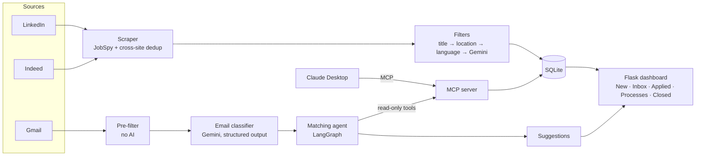

# JobBot

**An AI job-search assistant that runs itself.** It scrapes LinkedIn and Indeed, uses an LLM to
filter out jobs I'm not qualified for, reads my Gmail to keep track of every application, and lets
me ask Claude about any of it in plain language.


I built it for my own job search, and I use it every day. It runs unattended on my laptop. Every
AI component was measured against labeled real data before it went live.

---

## What it does

| | |
|---|---|
| 🔎 **Find** | Scrapes LinkedIn and Indeed every 6 hours for 9 roles around Tel Aviv, and removes the same job posted on both sites. |
| 🧠 **Filter** | Rule-based filters, then Gemini: drops jobs that ask for more experience than I have, or belong to a different profession. Tuned for recall, so a good job is almost never hidden. |
| 📋 **Track** | A local dashboard: New → Applied → Process / Closed, with notes on every interview process. |
| 📬 **Read my mail** | A **LangGraph agent** reads application emails (confirmations, rejections, interview invites, home tasks), works out which job each one is about, and suggests the status update. Nothing changes until I click Accept. |
| 💬 **Talk to it** | An **MCP server** gives Claude Desktop the tracker: *"I have an interview Wednesday with Acme"* → it finds the job, moves it to Process, and offers interview prep. |

## Architecture



One MCP server serves two clients: Claude Desktop, and my own LangGraph agent. The agent gets only
the server's *read* tools, so nothing in an email can make it change my data.

---

## Highlights

### 1. LLM filtering, tuned by evaluation instead of by feel
The hard part of filtering is the requirements text: "3+ years", "2–4 years", "B.Sc. *or*
equivalent military service", "extensive experience" with no number. Regex couldn't keep up, so
Gemini reads every posting that survives the cheap rule-based filters.

I didn't trust the prompt by looking at a few outputs. My own dashboard clicks became the labels:
**Applied = should show, Deleted = shouldn't**. `qa/prompt_eval.py` scores prompt variants on those
labels, with **recall as the primary metric** (a hidden good job costs more than one extra job to
skim) and Wilson confidence intervals, so small differences aren't mistaken for wins.

| Prompt | Recall | Precision | False-positive rate |
|---|---|---|---|
| Original (years only) | 0.971 | 0.237 | 0.33 |
| **Production: quote-first + "right profession?" check** | **1.000** | **0.309** | **0.24** |

What the eval taught me:
- **Never ask the model for the final yes/no.** The model sometimes reported "1 year required" and
  then answered `fit = false` anyway. Now it only reports the facts (years, relevant field), and
  Python makes the decision.
- **Make it quote the requirement sentence before judging it.** That removed a whole class of
  misreadings.
- **Most false positives weren't about years at all.** They were the wrong profession (BI, pre-sales,
  support), so the production prompt judges that separately.
- **Identical runs disagree on ~30% of borderline jobs.** A one-job difference between variants is
  noise; I judge changes on stable flips and on recall.

### 2. A Gmail agent with LangGraph + MCP
Applications made anywhere (LinkedIn, company sites, referrals) end up in my inbox. The agent turns
that mail into an up-to-date tracker:

1. **Pre-filter (no AI):** skips Promotions/Social, job alerts, login codes and my own sent mail.
2. **Classify (one Gemini call):** the email's type, plus the *employer* (not the hiring platform
   that sent it, e.g. Comeet or Workday), the role, and any requisition ID.
3. **Match (the agent):** a LangGraph loop that searches the tracker through MCP tools until it can
   answer *which job is this?* Real cases it had to handle:
   - "Thank you from &lt;company&gt;" with dozens of rows for that company and no role named
   - Indeed notices that name only the role, never the company
   - Hebrew emails naming a company that the tracker stores in English
   - the same role reposted under a new listing weeks later
4. **Suggest:** one Inbox card per job, built from the job's *current* status:

```
 Junior Data Engineer — Acme                         [Close - rejected]  now: applied
 ┃ "After careful consideration, we have decided to move forward with other candidates."
   Oct 20 · rejection · Your application to Acme
   Oct 02 · confirmation · Thanks for applying to Acme!
 [ Accept ]  [ Dismiss ]
```

| Component | Measured on 60 days of my real mail |
|---|---|
| Email classifier | 99.6% type accuracy, 100% recall on application emails |
| Matching agent | 99.4% correct job match |

The eval scored the classifier and the agent separately: the agent was fed the classifier's saved
outputs, so one stage's mistakes couldn't hide in the other's score. The eval also caught mistakes
in the labels themselves, such as rejections hiding behind "Thank you for applying" subject lines,
and those were fixed before the numbers above were measured.

Design choices I'd defend in a review:
- **Human in the loop:** the agent never writes. Accept recomputes the action on the server, and
  the form only says *which* card was clicked.
- **Rules in code, not in the prompt:** the model reports "ambiguous + candidates", and Python
  applies the policy (act on the oldest application). The rule is deterministic and unit-tested.
- **Graceful failure:** a network error retries once; the checkpoint only advances when every email
  succeeded, so a crash never loses mail.
- **Skipped a dependency on purpose:** `langchain-mcp-adapters` pins the old MCP SDK, and installing
  it silently downgraded the SDK and broke my server. The adapter's job is ~20 lines, so I wrote
  them myself.

### 3. An MCP server for Claude Desktop
`mcp_server.py` exposes the tracker as tools (`search_jobs`, `get_job`, `mark_applied`,
`move_to_process`, `add_note`, `get_stats`, ...), a `profile://me` resource, and an
`interview_prep` prompt. Every tool wraps the same `db.py` functions as the dashboard, so the
status rules (for example, an applied counter that counts each application exactly once) can't
drift between interfaces. Integration tests start the server as a subprocess, the way Claude
Desktop does.

### 4. Built to run unattended
- **Windows Task Scheduler** fires the pipeline every 15 minutes; it throttles itself and only does
  real work every 6 hours. Runs under `pythonw`, so no console window ever flashes.
- **After sleep or shutdown**, the next run widens its search window to cover the gap, capped at
  4 days.
- **One bad row never stops a run.** A single missing company name once broke every scrape for
  18 days while the dashboard quietly showed a stale date. Now each row is isolated and logged.
- **Both sites' quirks are handled:** Indeed's "hours old" filter only works in day-sized steps (it
  returns nothing under 48h), so its window has a 48h floor. JobSpy dropped every LinkedIn posting
  date because of a CSS-selector gap, which I confirmed by comparing raw HTML and patched at import
  time.

---

## Privacy by design
This project reads my email, so the boundaries are strict:
- **Gmail access is read-only** (`gmail.readonly`). Even a leaked token can't send or delete mail.
- **The agent's tools are read-only too**, through an explicit allowlist. Data changes only on my
  click.
- **Personal data never reaches this repo.** Emails, labels, the jobs DB, OAuth tokens and anything
  revealing which jobs I applied to are gitignored. Tests and examples use made-up companies.
- See [PRIVACY.md](PRIVACY.md).

## Tech stack
**Python 3.12** · **LangGraph** + **LangChain Core** · **MCP** (Python SDK 2.x) · **Google Gemini**
(`gemini-3.1-flash-lite`, structured output) · **Gmail API** (OAuth 2.0) · **python-jobspy** ·
**pandas** · **Flask** · **SQLite** · **Windows Task Scheduler**

## Project layout
```
JobBot/
├── pipeline.py · app.py · mcp_server.py   # entry points (paths used by Task Scheduler / Claude Desktop)
├── src/jobbot/
│   ├── scraper.py, pipeline.py            # scraping, dedup, scheduling
│   ├── filters/                           # title, location, language, Gemini
│   ├── db.py                              # SQLite schema, statuses, applied counter
│   ├── webapp.py, templates/              # Flask dashboard
│   ├── mcp_server.py                      # MCP server
│   ├── gmail_client.py, gmail_prefilter.py
│   ├── gmail_classifier.py                # email -> type / company / role
│   ├── gmail_matcher.py                   # LangGraph matching agent
│   ├── gmail_agent.py                     # fetch -> classify -> match -> store
│   └── gmail_suggestions.py               # Inbox rules (what Accept does)
├── qa/                                    # evals, labeling tools, integration tests
└── scripts/
```

## Running it
```bash
pip install -r requirements.txt
cp .env.example .env            # add your GEMINI_API_KEY
python pipeline.py --force      # scrape + filter once
python app.py                   # dashboard at http://localhost:5000
```

**Optional, Gmail:** create a *Desktop app* OAuth client in Google Cloud (Gmail API, scope
`gmail.readonly`), save it as `data/gmail_credentials.json`, then run `python scripts/gmail_run.py`
and log in once. After that the agent runs after every scheduled scrape.

**Optional, Claude Desktop:** add `mcp_server.py` to `claude_desktop_config.json` as a stdio server.

**Tests:** `python qa/test_gmail_suggestions.py` · `python qa/test_mcp_server.py`
